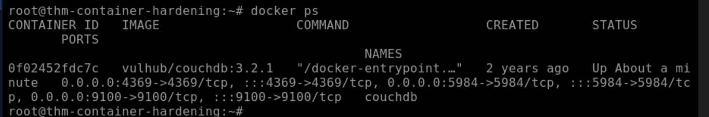
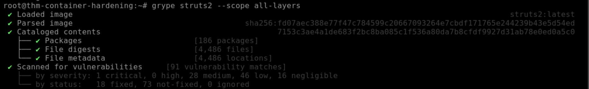
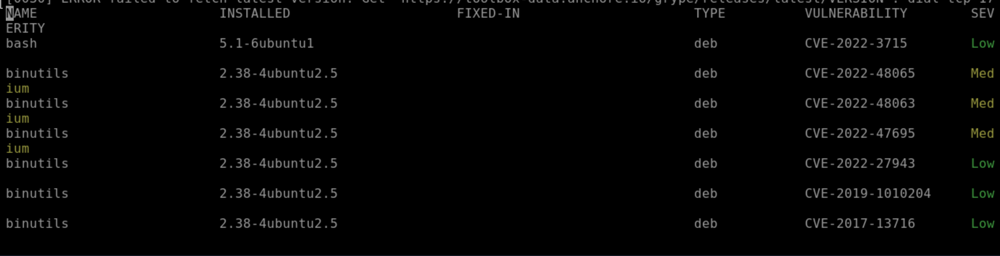
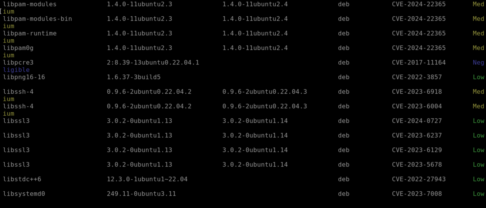
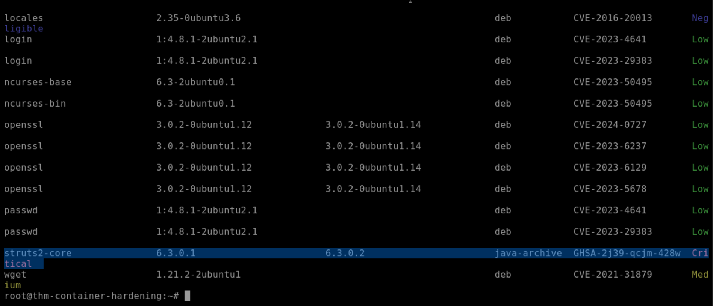
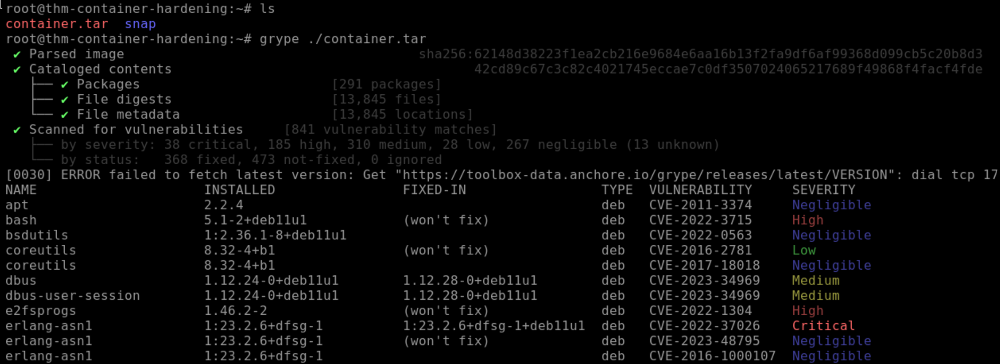
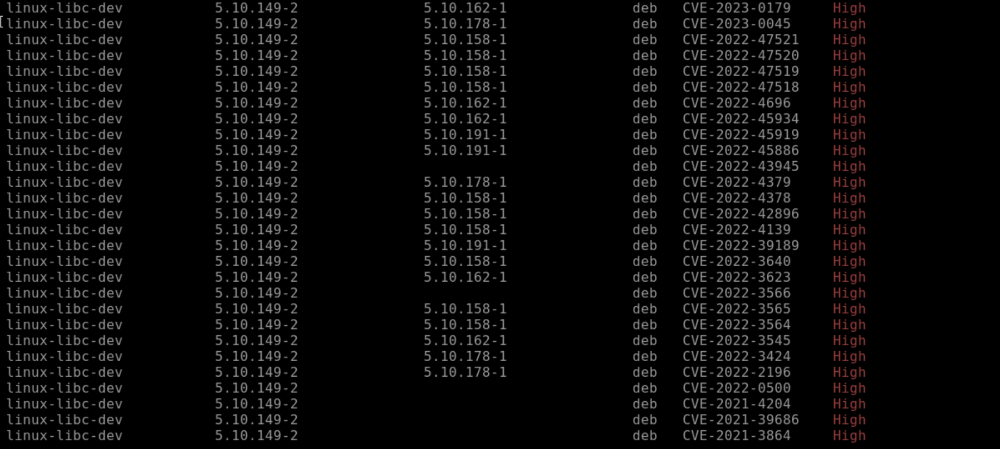
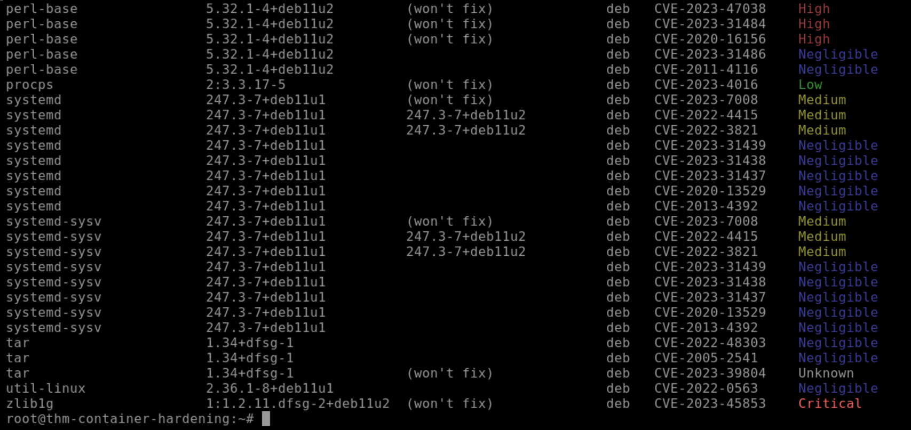

> /DevSecOps/Container Hardening


# Container Hardening: Defense-in-Depth Beyond the Defaults

Containerization revolutionized deployment pipelines, but running application code inside a container does not mean it is secure by default. Out-of-the-box configurations favor usability over strict isolation. When security defaults are left unchecked, containers often operate with excessive Linux capabilities, shared kernel privileges, unmonitored system calls, and unconstrained host resources.

Securing a containerized environment requires a defense-in-depth model. We must secure the controlling Docker daemon, enforce strict resource limits, strip unnecessary Linux kernel capabilities, and restrict system-level operations using kernel isolation tools like `Seccomp` and `AppArmor`.

## Securing the Attack Surface

Before diving into runtime profiles, we need to address the most critical entry point in any container environment: the Docker daemon (`dockerd`). The daemon runs with root privileges on the host system. If an adversary gains unauthorized interaction with the Docker daemon API, they effectively control the host system itself.

```text
Host Architecture

[ Client / CI/CD ] ---> ( Encrypted & Authenticated Socket ) ---> [ Docker Daemon (dockerd) ]
                                                                        |
                                                                  +-----+-----+
                                                                  |           |
                                                            [ Container ] [ Container ]

```

## Daemon Communication Models

By default, Docker operates via a local Unix socket (`/var/run/docker.sock`). When managing containers remotely—such as in CI/CD build environments—the daemon API is frequently exposed over the network. Unprotected TCP ports (like default port `2375`) create instant system compromise vectors.

| Vector | Configuration Standard | Security Mechanism |
| --- | --- | --- |
| `SSH Contexts` | `docker context create --docker host=ssh://user@host` | End-to-end SSH key authentication; encrypts API calls natively. |
| `TLS Authentication` | `dockerd --tlsverify --tlscacert=ca.pem -H=0.0.0.0:2376` | Mutual TLS (mTLS); requires valid client certificates signed by internal CA. |

Let's look at how we issue remote commands over a secured TLS-enabled daemon port:

```bash
docker --tlsverify --tlscacert=myca.pem --tlscert=client-cert.pem --tlskey=client-key.pem -H=10.10.14.5:2376 info

```

Without a valid certificate explicitly signed by the internal Certificate Authority (`myca.pem`), the daemon immediately drops incoming TCP connections.


## Restricting Host Resource Exhaustion

A compromised or malfunctioning application within a container can trigger Denial of Service (DoS) conditions by consuming all available host RAM or CPU cycles. Linux Control Groups (`cgroups`) prevent resource starvation by enforcing hard boundaries on running containers.

Let's see how to launch an Nginx web server and constrain its execution profile to 1 CPU core and 40MB of RAM:

```bash
docker run -d --name hardened-web --cpus="1.0" --memory="40m" nginx:latest

```

We can inspect a running container's resource configuration using `docker inspect` to verify active `cgroup` enforcement:

```bash
docker inspect hardened-web | grep -E "Memory|CpuQuota"

```

```json
            "Memory": 41943040,
            "CpuQuota": 100000,

```

Setting explicit limits ensures that even if an application suffers a severe memory leak or runs a malicious cryptominer, the impact remains isolated to the designated container limits.

# Principal of Least Privilege: Capabilities & Isolation

By default, Docker executes non-privileged containers with a restricted set of root privileges. However, executing containers with the `--privileged` flag strips all isolation boundaries, presenting the container with full root access to the host kernel, physical devices, and file systems.

## Fine-Tuning Capabilities

Rather than granting blanket root permissions using `--privileged`, Linux `capabilities` allow us to grant only the exact system privileges an application requires.

```text
Capability Allocation Strategy

[ Strip ALL Capabilities ]  --->  `--cap-drop=ALL`
                                       |
[ Add Required Service Caps ] --->  `--cap-add=NET_BIND_SERVICE`

```

Common administrative capabilities and their operational contexts include:

| Capability | Purpose | Least Privilege Standard |
| --- | --- | --- |
| `CAP_NET_BIND_SERVICE` | Binds processes to system ports under 1024. | Required for web servers running on ports `80` or `443`. |
| `CAP_SYS_ADMIN` | Grants broad administrative actions (mount, reboot, namespace edits). | **Dangerous.** Avoid enabling in production containers. |
| `CAP_SYS_RESOURCE` | Overrides resource limits and quota restrictions. | Reserve strictly for host monitoring agents. |

To enforce a hardened runtime configuration, let's start a web container by dropping all default capabilities and explicitly adding only `NET_BIND_SERVICE`:

```bash
docker run -d --name secure-app --cap-drop=ALL --cap-add=NET_BIND_SERVICE nginx:latest

```

To inspect the process capabilities from within the container environment:

```bash
docker exec secure-app capsh --print

```

```text
Current: = cap_net_bind_service+ep
Bounding set =cap_net_bind_service
Ambient set =

```

# Kernel Enforcement: Seccomp & AppArmor

Restricting capabilities limits what a process can do, but kernel protection mechanisms like `Seccomp` and `AppArmor` control how containers interact directly with the Linux operating system.

## Enforcing System Call Rules with Seccomp

`Seccomp` (Secure Computing Mode) acts as a system call firewall. It monitors the application's interactions with the kernel and blocks blocked system calls (like `execve` or `socket`) before execution completes.

Let's review a custom JSON Seccomp profile (`block-exec.json`) designed to deny process execution calls (`execve` / `execveat`) while allowing normal file I/O:

```json
{
  "defaultAction": "SCMP_ACT_ALLOW",
  "architectures": [
    "SCMP_ARCH_X86_64"
  ],
  "syscalls": [
    {
      "names": [ "execve", "execveat" ],
      "action": "SCMP_ACT_ERRNO"
    }
  ]
}

```

Now to apply this custom Seccomp profile when launching our target container:

```bash
docker run --rm -it --security-opt seccomp=./block-exec.json alpine:latest sh

```

If an adversary drops a payload inside this container and attempts to launch a binary, the kernel intercepts the system call and immediately returns an permission error (`SCMP_ACT_ERRNO`).


## Mandatory Access Control via AppArmor

While Seccomp inspects raw system calls, `AppArmor` enforces Mandatory Access Control (MAC) policies at the operating system level, explicitly limiting file access paths, raw network sockets, and capabilities.

Now to verify that the host kernel has AppArmor active:

```bash
sudo aa-status

apparmor module is loaded.
34 profiles are loaded.
```

Next, let's load a custom AppArmor profile (`docker-apache-secure`) into the kernel using `apparmor_parser`:

```bash
sudo apparmor_parser -r -W ./docker-apache-secure

```

Once loaded, apply the policy to the target container during execution:

```bash
docker run -d --name hardened-apache --security-opt apparmor=docker-apache-secure apache2:latest

```

# Image Audit & Vulnerability Scanning

Hardening container runtime parameters is useless if the base image itself contains backdoors, outdated libraries, or unpatched vulnerabilities (CVEs).

## Auditing Image Layers with Dive

Tools like `Dive` allow security engineers to reverse engineer container images layer-by-layer to discover hidden files, hardcoded credentials, or unnecessary build tools left behind during creation.

Let's run `dive` against a local image to analyze its filesystem changes per layer:

```bash
dive nginx:latest

```

```text
Image Details ──────────────────────────────
Total Image Size: 91 MB
Wasted Space: 2.1 MB
Efficiency Score: 98 %

Layer Details ───────────────
├── FETCH [http://dl-cdn.alpinelinux.org/alpine/v3.18/main](http://dl-cdn.alpinelinux.org/alpine/v3.18/main)
├── ADD file:a3423f... in / 
└── RUN /bin/sh -c apk add --no-libc nginx

```

## Vulnerability Benchmarking with Docker Scout

Before deploying images to production registries, we perform static analysis and Software Bill of Materials (SBOM) audits using vulnerability scanners like `Docker Scout` or `Grype`.

To run `docker scout` to identify critical system vulnerabilities inside an `nginx:latest` image:

```bash
docker scout cves local://nginx:latest

```

```text
## Overview
                    │        Analyzed Image         
────────────────────┼───────────────────────────────
  Target            │  local://nginx:latest        
  digest            │  4df6f9ac5341                
  platform          │ linux/amd64                  
  vulnerabilities   │   0C     1H    18M    28L    

## Packages and Vulnerabilities
   0C     1H     1M     3L  glibc 2.35-0ubuntu3.1
   ✗ HIGH CVE-2023-4911
     Affected range : <2.35-0ubuntu3.4                               
     Fixed version  : 2.35-0ubuntu3.4                               
     CVSS Score     : 7.8                                           

```

The output highlights a `HIGH` severity vulnerability (`CVE-2023-4911`) in `glibc`. Reviewing these findings enables engineers to update base images to fixed patch versions prior to deployment.

# The Container Security Checklist

A secure container implementation relies on several layers of defensive controls across both build time and runtime environment:

| Security Domain | Operational Control | Primary Defense Target |
| --- | --- | --- |
| `Daemon Protection` | Enforce SSH Contexts or mTLS port `2376`. | Prevents unauthorized host takeovers via exposed Docker sockets. |
| `Resource Control` | Apply `--memory` and `--cpus` limits. | Mitigates local DoS and resource starvation attacks. |
| `Privilege Control` | Execute with `--cap-drop=ALL` and selective `--cap-add`. | Eliminates arbitrary root access inside host namespaces. |
| `System Integrity` | Apply custom `Seccomp` and `AppArmor` profiles. | Restricts system call execution and limits unauthorized file system access. |
| `Supply Chain` | Audit images with `Dive` and scan via `Docker Scout`. | Prevents deployment of vulnerable base images and malicious code. |

## Hardening Implementation Strategy

To secure a vulnerable container setup, we implement these runtime protections directly during the launch phase.

### Enforcing Container Hardening at Runtime

Let's execute a hardened web container incorporating least-privilege capabilities, constrained host resources, and custom kernel protection profiles:

```bash
docker run -d \
  --name hardened-prod-web \
  --read-only \
  --cpus="1.0" \
  --memory="128m" \
  --cap-drop=ALL \
  --cap-add=NET_BIND_SERVICE \
  --security-opt seccomp=./seccomp-web-profile.json \
  --security-opt apparmor=docker-nginx-secure \
  nginx:latest

```

By specifying `--read-only`, we turn the container's root filesystem into a read-only volume. This prevents attackers from dropping secondary malicious binaries or modifying configuration files, even if an application-level vulnerability is exploited.


# Container Vulnerability Analysis with Grype

Now that we have established the theoretical security controls, let's put theory into practice. In this section, we transition to an active investigation environment to audit running containers, inspect Docker image layers, and scan exported container filesystems using the open-source vulnerability scanner **Grype**.

### Identifying Running Assets

Before auditing vulnerabilities, we need to establish asset visibility across our target system. 

Let's inspect the active environment to identify running container workloads:

```bash
docker ps

```



The output confirms our target **running container name:** `couchdb`

### Deep Image Layer Inspection with Grype

Scanning a container's runtime memory is often insufficient because vulnerable libraries can reside within unexecuted image layers. To perform an exhaustive audit, we utilize Grype with `--scope all-layers` to scan every layer present in the image build history.

Let's execute Grype against the `struts2` image:

```bash
grype struts2 --scope all-layers

```










Reviewing the vulnerability findings, the scan flags a severe security flaw in the Apache Struts core framework. **Critical Library Identified:** `struts2-core`, associated with critical Remote Code Execution vulnerabilities like CVE-2017-5638.

### Auditing Exported Container Filesystems

In forensic scenarios or offline CI/CD pipelines, security engineers often analyze exported container filesystems (`tar` archives) directly without loading them into the local Docker daemon.

Let's run Grype against the exported container filesystem located at `/root/container.tar`:

```bash
grype /root/container.tar

```







Filtering the resulting vulnerability report for `CVE-2023-45853`:

```text
NAME         INSTALLED   FIXED-IN   TYPE   VULNERABILITY    SEVERITY
zlib         1.2.11      (won't fix)     deb   CVE-2023-45853   Critical

```

**CVE-2023-45853 Severity Rating:** `Critical`


# Wrapping Up the Scene

Hardening containerized environments requires addressing both runtime security configurations and supply-chain vulnerabilities. While configuring `cgroups`, dropping capabilities, and enforcing `Seccomp` or `AppArmor` profiles significantly reduces the attack surface, scanning images for known CVEs ensures that vulnerable libraries never reach production. Incorporating tools like Grype into CI/CD pipelines provides the continuous visibility needed to catch security issues before they can be exploited.

---

> QXV0aG9yOiBodHRwczovL2dpdGh1Yi5jb20vaGFzaC01NDU=
