> /DevSecOps/Kubernetes

# Kubernetes Clusters & Basic Hardening

Managing a few containers is straightforward. Managing hundreds across multiple machines, scaling workloads, and replacing failed instances is a different story. **Kubernetes (K8s)** solves this through container orchestration, automating deployment, scaling, and recovery.

A Kubernetes cluster consists of a **control plane**, which manages the cluster, and **worker nodes**, which run applications.

| Component | Role |
|---|---|
| `kube-apiserver` | Entry point for cluster requests |
| `etcd` | Stores cluster state |
| `kube-scheduler` | Assigns pods to nodes |
| `kubelet` | Ensures pods run on worker nodes |
| `kube-proxy` | Helps manage Service networking |
| Container runtime | Runs containers |

The smallest deployable unit is a **Pod**, which contains one or more containers.

```text id="k8s01"
Kubernetes Cluster
├── Control Plane
│   ├── API Server
│   ├── etcd
│   └── Scheduler & Controllers
└── Worker Nodes
    ├── Kubelet
    └── Pods → Containers
```

## Kubernetes Resources In Practice

These are the resources we'll interact with when deploying and securing workloads.

| Resource | Purpose |
|---|---|
| Namespace | Organizes and isolates resources |
| Deployment | Manages application replicas and updates |
| ReplicaSet | Maintains the desired number of pods |
| StatefulSet | Manages workloads needing stable identities |
| Service | Provides a stable endpoint for accessing pods |
| Ingress | Routes HTTP/HTTPS traffic to services |

Deployments are commonly used for stateless applications, while StatefulSets suit workloads requiring stable identities and storage associations. Services provide stable network access even when pods are replaced.


# Configuring Kubernetes Resources

Kubernetes uses YAML manifests to define the desired state of resources. Each manifest typically includes `apiVersion`, `kind`, `metadata`, and `spec`. Let's connect a Deployment to a Service using two configuration files.

## Defining The Service

The Service provides a stable endpoint for accessing pods matching its selector.

```yaml
apiVersion: v1
kind: Service
metadata:
  name: example-nginx-service
spec:
  selector:
    app: nginx
  ports:
    - protocol: TCP
      port: 8080
      targetPort: 80
  type: ClusterIP
```

Here, `port: 8080` is the Service port, while `targetPort: 80` forwards traffic to the application inside the pods. `ClusterIP` makes the Service accessible within the cluster.

## Deploying The Application

Next, the Deployment defines the desired number of replicas and the container image to run.

```yaml
apiVersion: apps/v1
kind: Deployment
metadata:
  name: example-nginx-deployment
spec:
  replicas: 3
  selector:
    matchLabels:
      app: nginx
  template:
    metadata:
      labels:
        app: nginx
    spec:
      containers:
        - name: nginx
          image: nginx:latest
          ports:
            - containerPort: 80
```

The Deployment maintains three pod replicas. Its `matchLabels` selector and the Service's `selector` both use `app: nginx`, connecting the Service to the correct pods.

## Applying The Configuration

Save the manifests as `service.yaml` and `deployment.yaml`, then apply them:

```bash
kubectl apply -f service.yaml
kubectl apply -f deployment.yaml
kubectl get deployments,pods,services
```

Kubernetes continuously reconciles the cluster's actual state with the desired state. If a pod fails, the Deployment works through its ReplicaSet to restore the requested replica count.

From a DevSecOps perspective, these manifests are also security review points. Avoid floating image tags such as `latest` in production, and review container privileges, resource limits, and network exposure before deployment.

## Managing Kubernetes With kubectl

`kubectl` lets us interact with the Kubernetes API server to deploy resources, inspect workloads, and investigate issues.

| Command | Purpose |
|---|---|
| `kubectl apply -f file.yaml` | Apply a configuration |
| `kubectl get pods` | Check pod status |
| `kubectl describe pod <name>` | Inspect resource details and events |
| `kubectl logs <pod>` | View container logs |
| `kubectl exec -it <pod> -- sh` | Open a shell inside a container |
| `kubectl port-forward service/<name> 8090:8080` | Forward a local port to a Service |

Add `-n <namespace>` when working in a specific namespace. For troubleshooting, start with `get`, inspect events using `describe`, and check application output with `logs`. Use `exec` when you need deeper access, and restrict that access to authorized users.

Port forwarding is useful for local testing without exposing an application publicly. Remember that `kubectl exec` provides direct access to a container, so it should be controlled and audited in production environments.

# Securing A Kubernetes Cluster

Kubernetes introduces security challenges beyond individual containers. Pods can communicate across the cluster, and overly permissive access or configurations can allow an attacker to move between workloads. DevSecOps engineers must secure workloads, restrict network traffic, control access, and continuously monitor activity.

## Hardening Workloads And Networks

Start with the pods themselves. Containers should run as non-root users, avoid privileged mode, use read-only filesystems where practical, and rely on regularly scanned, trusted images. Kubernetes **Pod Security Standards (PSS)** provide three levels of enforcement guidance: `privileged`, `baseline`, and `restricted`.

**Network security** is equally important. Restrict control-plane access, use TLS for secure communication, and apply explicit NetworkPolicies to limit pod-to-pod traffic. Without restrictive policies and a compatible network plugin, workloads may communicate more freely than intended.

**Sensitive information** should never be hardcoded into manifests or application images. Kubernetes Secrets provide a dedicated mechanism for managing credentials, but their values are Base64-encoded by default, not encrypted. Configure encryption at rest, restrict access through RBAC, and consider an external secrets manager for stronger controls.

## Authentication, Authorization, And Monitoring

Kubernetes uses authentication to establish identity and authorization to determine permitted actions. **Role-Based Access Control (RBAC)** allows permissions to be scoped to specific resources and operations. Apply least privilege to users, groups, and service accounts, and avoid granting broad cluster-admin access unnecessarily.

For example, a Role can restrict a team to reading pods within a namespace rather than allowing them to create or delete resources across the cluster. Review permissions regularly and remove unused service accounts and access bindings.

Enable Kubernetes audit logging and forward relevant events to a monitoring platform. Alerts for unusual API activity, privilege changes, suspicious container execution, and unexpected workload creation can help detect potential compromise. Keep the cluster patched, scan images and configurations regularly, and remove obsolete components.

## Three Controls To Know

**RBAC:** Defines who can perform which actions on Kubernetes resources. Permissions are expressed through rules specifying resources and verbs such as `get`, `list`, `create`, and `delete`.

**Secrets management:** Protects credentials and other sensitive data through restricted access, encryption at rest, careful handling, and rotation. Base64 encoding alone provides no confidentiality.

**Pod Security Admission (PSA):** Enforces Pod Security Standards at the namespace level. The `privileged` profile is broadly permissive, `baseline` blocks common privilege escalations, and `restricted` applies stronger workload-hardening requirements. PodSecurityPolicy (PSP) was removed in Kubernetes v1.25, so modern clusters should use PSA or an appropriate alternative.

These controls work best together: restrict what workloads can do, limit who can manage them, control their communication, and monitor changes continuously. Security is an ongoing process, not a one-time configuration.

# Kubernetes In Practice: Explore, Investigate, Secure

Now let's put the theory into practice. We'll start a Minikube cluster, deploy an Nginx application, investigate exposed credentials, and use RBAC to restrict access to a Kubernetes Secret.

## I - Exploring The Cluster

In my current sandbox, I'll start Minikube and inspect the existing workloads across all namespaces.

```bash
minikube start
```

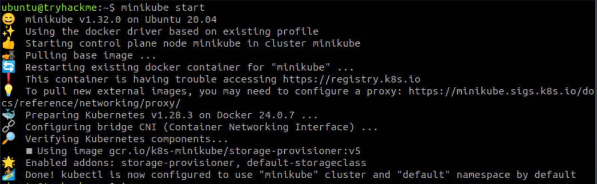


```bash
kubectl get pods -A
```

This shows the current running pods and  workload active.

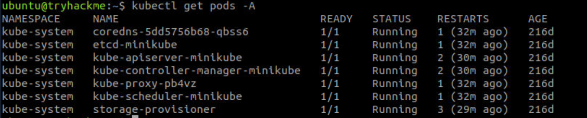


Next, let's inspect the provided configuration files in `~/Desktop/configuration`


```bash
cat ~/Desktop/configuration/nginx-deployment.yaml

```

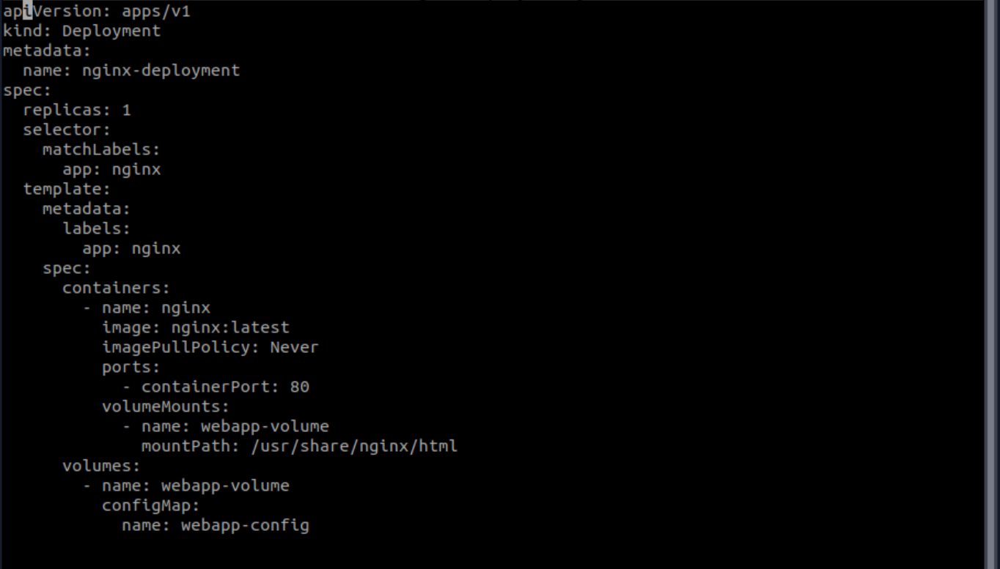


```bash
cat ~/Desktop/configuration/nginx-service.yaml
```

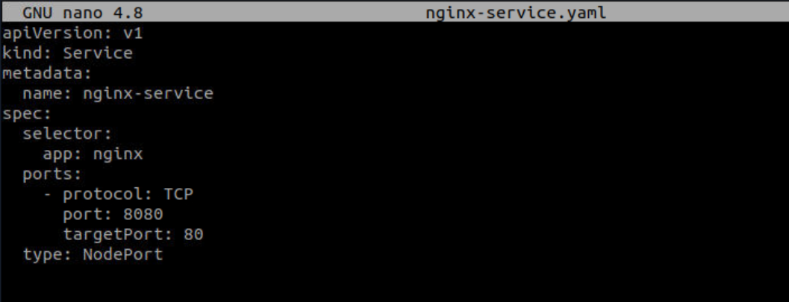

The Deployment defines an Nginx pod, while the NodePort Service exposes the application. Check that the Service selector matches the pod labels and that its `targetPort` matches the container port.

Now applying the Service first, followed by the Deployment:

`kubectl apply -f ~/Desktop/configuration/nginx-service.yaml`

`kubectl apply -f ~/Desktop/configuration/nginx-deployment.yaml`

Configuration is applied successfully and we get a success response

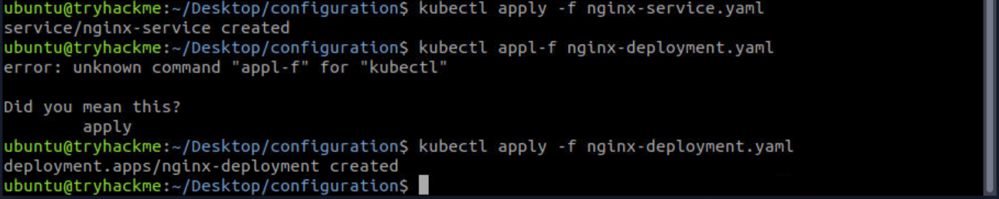

Verify that the application starts:

`kubectl get pods -A`

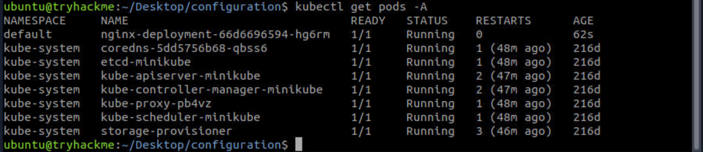

As we can see, our `nginx` application has been deployed and running on pods. Now, let's move to next phase.

## II - Investigating Exposed Credentials

Let's access the Nginx application through port forwarding:

```bash
kubectl port-forward service/nginx-service 8090:8080
```

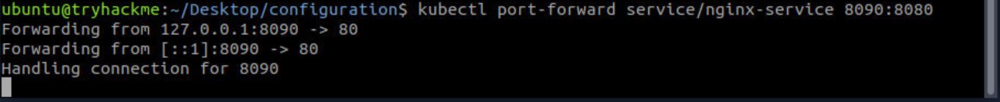

With port forwarding active, i'll open `http://localhost:8090/` in Firefox. The application presents a login terminal. Let's check whether the cluster contains a Secret holding the required credentials. On a second terminal, we can keep the port-forwarding session running.

**The website running**

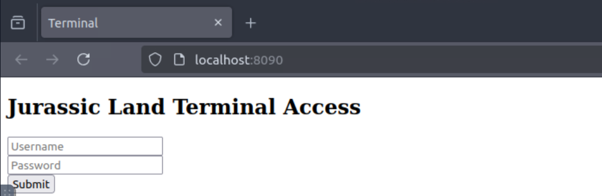


We can inspect the `terminal-creds` (sandboxed) Secret for its metadata and stored data keys:


```bash
kubectl describe secret terminal-creds
```
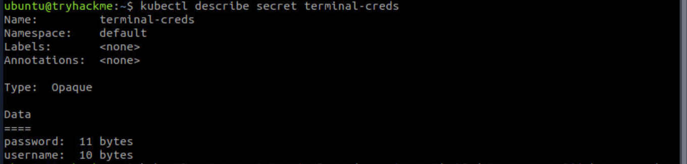


Kubernetes Secrets are Base64-encoded by default, but that encoding does not provide encryption. If our current identity has sufficient permissions, we can retrieve and decode the stored values.

Let's retrieve the username:

**`kubectl get secret terminal-creds -o jsonpath='{.data.username}' | base64 --decode`**

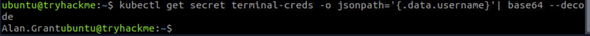

And then the password:

**`kubectl get secret terminal-creds -o jsonpath='{.data.password}' | base64 --decode`**

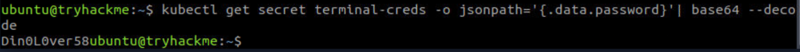

Using these credentials to access the terminal. 


We've now seen how excessive Secret permissions can expose sensitive information, even when credentials aren't directly visible in a configuration file.

## III - Restricting Access With RBAC

Let's tighten access by creating two service accounts: `terminal-user` for routine activities and `terminal-admin` for authorized access to the credentials.

**`kubectl create sa terminal-user`**

**`kubectl create sa terminal-admin`**


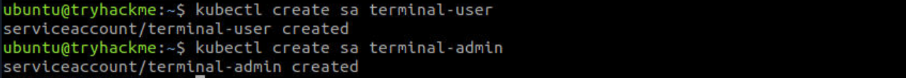

Now let's inspect the supplied Role and RoleBinding manifests in `~/Desktop/configuration/rbac`:

**`cat ~/Desktop/configuration/rbac/role.yaml`**

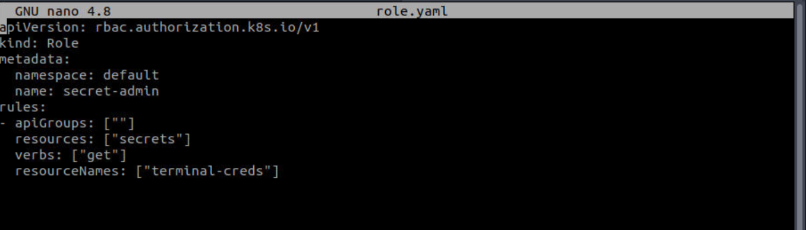

**`cat ~/Desktop/configuration/rbac/role-binding.yaml`**

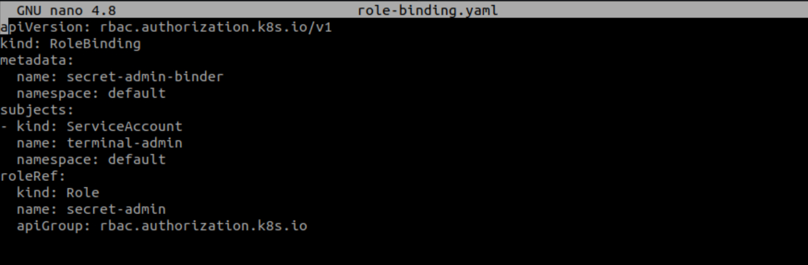


The `secret-admin` Role grants the `get` permission on the specific `terminal-creds` Secret. The RoleBinding connects that Role to the `terminal-admin` service account. This lets us grant access to one resource without handing out broad administrative privileges.

Let's apply both configurations:

**`kubectl apply -f ~/Desktop/configuration/rbac/role.yaml`**

**`kubectl apply -f ~/Desktop/configuration/rbac/role-binding.yaml`**

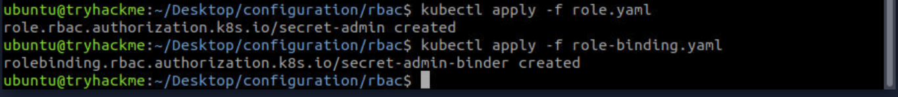


Time to confirm that our permissions work as intended using `kubectl auth can-i`. First, check whether the regular service account can retrieve the Secret:

**`kubectl auth can-i get secret/terminal-creds --as=system:serviceaccount:default:terminal-user`**

We expect `no`. 

Next, check the administrative account:

**`kubectl auth can-i get secret/terminal-creds --as=system:serviceaccount:default:terminal-admin`**

We expect `yes`.

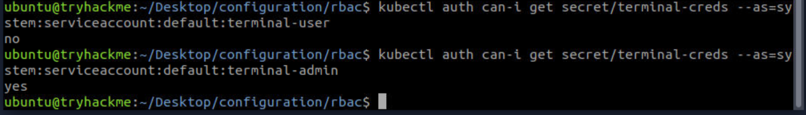

These checks test authorization rather than retrieving the Secret itself. They also depend on the manifests being applied correctly and our current identity having permission to impersonate the service accounts.

With RBAC in place, we've restricted which service account can retrieve these credentials. Let's build on that protection in production with encryption at rest, carefully scoped service-account permissions, audit logging, and regular access reviews.


## From Cluster Exploration To Access Control

Kubernetes security requires continuous attention to workload configurations, access permissions, and exposed credentials. By investigating the cluster and enforcing least-privilege RBAC, we've taken practical steps toward reducing `unauthorized access`. These controls become even more effective when combined with encrypted Secrets, audit logging, and regular security reviews.

---

> QXV0aG9yOiBodHRwczovL2dpdGh1Yi5jb20vaGFzaC01NDU=
