> /DevSecOps/On-PremIaC

# On-Prem Infrastructure as Code

As enterprise workloads migrate toward multi-cloud architectures, the instinct is often to view on-premises data centers as legacy tech. However, in heavily regulated sectors—such as financial institutions, healthcare providers, and defense contractors—retaining absolute authority over compute, storage, and networking layers remains a core compliance requirement. 

On-premises Infrastructure as Code (IaC) bridges the gap between modern programmatic automation and strict data sovereignty requirements. Rather than sacrificing deployment speed for security, organizations can leverage local provisioning frameworks to enforce immutable infrastructure standards behind air-gapped perimeters.

Understanding on-prem IaC requires balancing its governance advantages against operational trade-offs, followed by mastering the core orchestration tools: **Vagrant** for hypervisor lifecycle management and **Ansible** for declarative configuration management.

# On-Premises IaC Architecture

On-premises IaC uses configuration files, template definitions, and automated playbooks to provision and maintain hardware, hypervisors, and virtual machines located within an organization's physical data centers.

```text
Control Plane Comparison

[ Cloud SaaS Model ]       ---> [ Third-Party Infra ]  ---> Shared Security Model

[ On-Premises IaC Model ]  ---> [ Air-Gapped Network ] ---> Absolute Stack Control

```

## Control vs. Convenience: SaaS vs. Self-Hosted

Choosing between cloud-managed SaaS solutions and on-premises IaC comes down to risk tolerance and operational ownership. Consider source code management: using a SaaS platform like GitHub transfers underlying host maintenance and infrastructure security to a third party. Conversely, deploying a self-hosted GitLab instance via on-prem IaC grants complete control over the application stack, network isolation (e.g., exposing access exclusively through internal VPN gateways), and access control lists.

| Metric | On-Premises IaC | Cloud-Based IaC |
| --- | --- | --- |
| `Data Control` | Absolute sovereignty; no external data transit. | Shared responsibility model; third-party risk exposure. |
| `Regulatory Compliance` | Simplified audit trails for strict frameworks (NIST, ISO 27001). | Requires cloud provider compliance attestations. |
| `Scalability` | Hard-capped by physical rack density and hardware limits. | Near-infinite horizontal and vertical scaling on demand. |
| `Cost Model` | High upfront CapEx (hardware); lower long-term OpEx. | Zero upfront CapEx; variable, recurring OpEx subscription fees. |

While on-prem IaC demands higher initial capital investment and operational accountability, it eliminates recurring cloud hosting fees and isolates critical deployment pipelines from public internet threats.

# Host Lifecycle Management with Vagrant

Where container runtimes like Docker handle isolated process virtualization, **Vagrant** operates at the hypervisor level. It acts as an abstraction layer across virtualization engines (`VirtualBox`, `VMware`, `Hyper-V`, `KVM`) to programmatically declare, spin up, and dismantle full virtual machine environments.

## Essential Vagrant Terminology

Understanding Vagrant requires mastering its core architectural concepts:

* **Provider:** The underlying hypervisor technology driving virtualization (e.g., VirtualBox, Docker, AWS EC2).
* **Box:** The packaged, reusable base image used to instantiate virtual machines (e.g., `ubuntu/bionic64`).
* **Provision:** Execution of scripts, file transfers, or configuration tools (like Ansible) to customize a booted VM.
* **Vagrantfile:** The central Ruby-syntax declarative manifest defining VM specs, network interfaces, and provisioning routines.

## Analyzing a Multi-Node Vagrant Manifest

Consider a scenario where an engineering team needs two isolated Ubuntu servers with distinct compute profiles, static IP assignments, and script execution paths.

Let's examine the structure of a multi-node `Vagrantfile`:

```yaml
Vagrant.configure("2") do |cfg|
  cfg.vm.define "server" do |config|
    config.vm.box = "ubuntu/bionic64"
    config.vm.hostname = "testserver"
    config.vm.provider :virtualbox do |v, override|
       v.gui = false 
       v.cpus = 1
       v.memory = 4096
    end

    config.vm.network :private_network,
        :ip => 172.16.2.101
    config.vm.network :private_network,
        :ip => 10.10.10.101
  end

  cfg.vm.define "server2" do |config|
    config.vm.box = "ubuntu/bionic64"
    config.vm.hostname = "testserver2"
    config.vm.provider :virtualbox do |v, override|
       v.gui = false 
       v.cpus = 2
       v.memory = 4096
    end

    #Upload resources
    config.vm.provision "file", source: "provision/files.zip",    destination: "/tmp/files.zip"

    #Run script
    config.vm.provision "shell", path: "provision/script.sh"
  end
end

```


To bring up the entire multi-node architecture in sequence, we run:

```bash
vagrant up

```

If we only need to target and instantiate a specific virtual machine from the manifest, we pass the server identifier directly:

```bash
vagrant up testserver

```

# Declarative State Management with Ansible

While Vagrant handles virtual hardware allocation, **Ansible** manages configuration state enforcement. Ansible is an agentless, open-source automation engine that uses YAML-based manifests to bring target systems into a desired operational state.

Unlike imperative shell scripts that execute commands sequentially regardless of current state, Ansible is **idempotent**. It evaluates the target system first and only applies modifications if the current state deviates from the declared playbook.

## Key Ansible Constructs

Ansible organizes configuration logic into a structured, modular hierarchy:

* **Playbook:** The master YAML manifest defining target hosts, privileged execution flags, and roles to execute.
* **Role:** A self-contained bundle of tasks, variables, templates, and handlers that can be reused across multiple playbooks.
* **Template:** Configuration files containing Jinja2 variables (`{{ variable_name }}`) dynamically injected at runtime.
* **Variable (`vars`):** Values stored in files that override defaults to customize role behavior per environment.

## Anatomical Breakdown of a Modular Ansible Role

A production-grade Ansible directory structure separates tasks, default values, and distribution-specific execution paths into distinct subdirectories:

```text
.
├── playbook.yml
└── roles/
    └── common/
        ├── defaults/
        │   └── main.yml
        ├── tasks/
        │   ├── apt.yml
        │   ├── main.yml
        │   └── yum.yml
        └── vars/
            ├── Debian.yml
            └── RedHat.yml

```

### The Master Playbook (`playbook.yml`)

The primary entry point connects target hosts to specific configuration roles and variable files:

```yaml
- name: Apply Base System Hardening
  hosts: all
  become: yes
  roles:
    - common
  vars_files:
    - variables/var.yml
```

### Dynamic Task Execution (`roles/common/tasks/main.yml`)

Ansible dynamically inspects facts gathered from target nodes (such as OS family) to run conditional installation routines:

```yaml

- name: Include Distribution Specific Variables
  include_vars: "{{ item }}"
  with_first_found:
    - "{{ ansible_distribution }}.yml"
    - "{{ ansible_os_family }}.yml"

- name: Enforce System Administrator Password
  user:
    name: root
    password: "xxxxxxxxxxxxxx"
  when: root_password is defined

- name: Execute Debian Package Management
  include_tasks: apt.yml
  when: ansible_os_family == "Debian"

- name: Execute RedHat Package Management
  include_tasks: yum.yml
  when: ansible_os_family == "RedHat"

```

# Hybrid Automation: Combining Vagrant & Ansible

Relying on a single tool can lead to operational bottlenecks. A robust strategy combines both frameworks: **Vagrant** provisions the underlying virtual machines on the hypervisor, while **Ansible** configures the operating systems and application stacks.

```text
Hybrid Execution Pipeline

[ Physical Hypervisor ]
         │
         ├──> ( Vagrant )  ---> Provisions VM Compute, Disks, & Interfaces
         │
         └──> ( Ansible )  ---> Connects via Local Provisioner & Applies System Roles

```

To configure Vagrant to automatically trigger a local Ansible playbook upon machine creation, add the `ansible_local` provisioner block to your `Vagrantfile`:

```ruby
config.vm.provision "ansible_local" do |ansible|
  ansible.playbook = "provision/playbook.yml"
  ansible.become = true
end

```

## Tool Comparison Matrix

| Feature | Vagrant | Ansible |
| --- | --- | --- |
| `Primary Focus` | Local development environments & VM lifecycle. | Enterprise configuration management & orchestration. |
| `Configuration Syntax` | Ruby DSL (`Vagrantfile`). | YAML (`Playbooks`). |
| `Execution Model` | Procedural / Step-by-Step. | Declarative / Idempotent State. |
| `Scope` | Small to mid-scale local VM topologies. | Large-scale, multi-tier enterprise deployments. |


# Deploying & Auditing an On-Premises IaC Pipeline

With the foundational architecture established, we now shift from theoretical concepts to an active deployment. In this practical investigation, we analyze, provision, and audit an on-premises Infrastructure as Code (IaC) environment utilizing **Vagrant** as the provider orchestrator and **Ansible** as the configuration engine.

Working out of `/home/ubuntu/iac/`, our target environment consists of a two-tier microservices architecture: a backend `MySQL` database container and a front-end web application container.


## Deconstructing the Hybrid Vagrant Orchestration

The root manifest (`Vagrantfile`) orchestrates multi-container initialization, static IP allocation, private network bridging, and local volume mounting using Docker as the hypervisor provider.

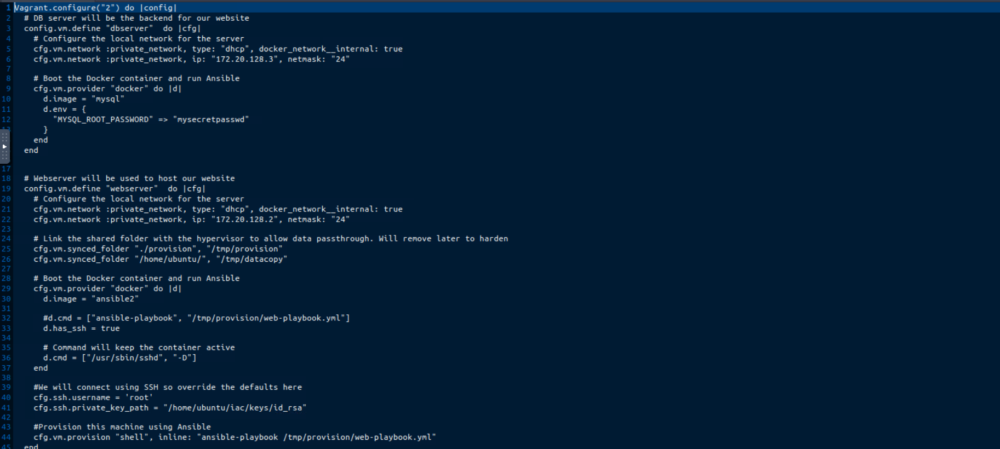

- **Database Container (`dbserver`):** Spawns a MySQL instance on `172.20.128.3` within an internal isolated network, initializing system credentials via environment variable passing.
- **Application Container (`webserver`):** Mounts local host directories (`./provision` -> `/tmp/provision`), binds SSH for control plane access, and executes inline shell commands to kick off internal Ansible provisioning.


## Auditing the Ansible Provisioning Engine

Once the base containers are initialized, Vagrant delegates state enforcement to Ansible via `/tmp/provision/web-playbook.yml`.

### Playbook & Task Structure

The master playbook targets local execution and delegates configuration tasks to the `webapp` role:

```yaml
- hosts: localhost
  connection: all
  roles:
    - webapp

```

Deep-diving into `roles/webapp/tasks/main.yaml` reveals two distinct setup phases:

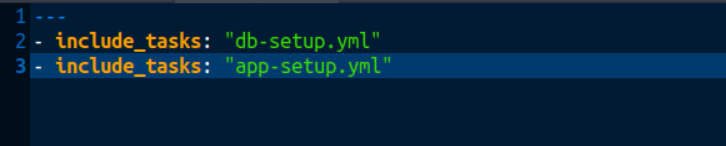

### Phase 1: Database Schema Injection (`db-setup.yml`)

The task handles automated database creation, stored procedure injection, and variable interpolation using centrally managed defaults (`roles/webapp/defaults/main.yml`):

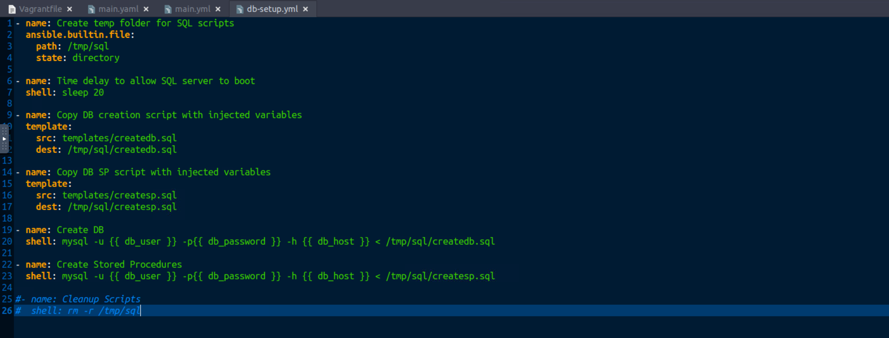

#### Centralized Variable Propagation

Ansible dynamically renders Jinja2 placeholders across database initialization templates (`templates/createdb.sql`), preventing credential duplication:

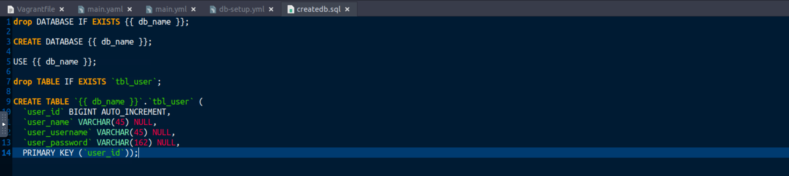

### Phase 2: Application Artifact Deployment (`app-setup.yml`)

The web setup phase stage-copies web application assets and dynamically templates the Flask application script with runtime database configuration strings:

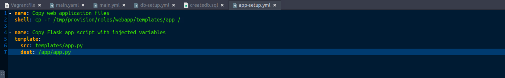

## Pipeline Execution & Verification

With our IaC manifests fully audited, we execute the automated deployment pipeline.

Trigger the full Vagrant-to-Ansible build sequence:

```bash
vagrant up

```

> We can ignore the warnings in red for time being. But, there shouldnt be any errors in the output.

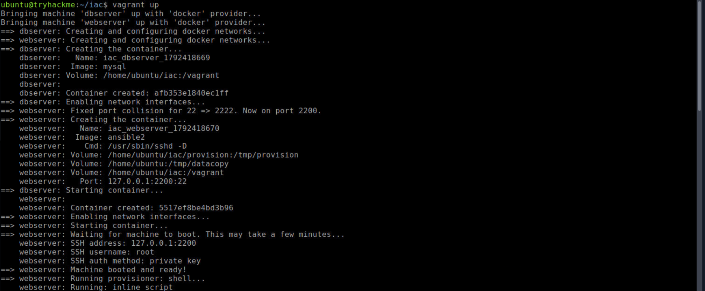

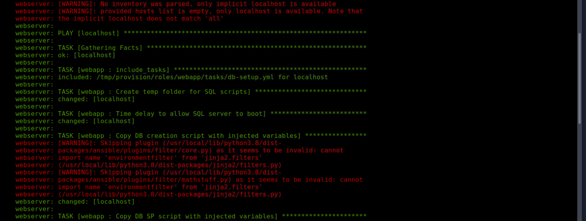

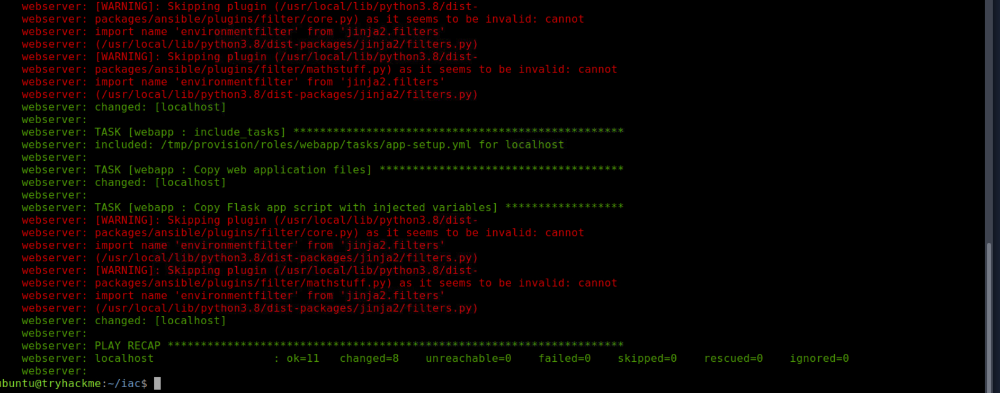

Once the pipeline completes execution, we verify active runtime assets across the host Docker daemon:

```bash
docker ps

```

The output confirms both provisioning targets are healthy and listening on their assigned network interfaces:

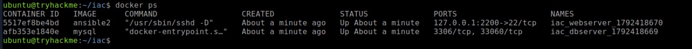


### Step 3: Application Initialization

Execute the deployed application inside the provisioned `webserver` workload:

```bash
vagrant docker-exec -it webserver -- python3 /app/app.py

```

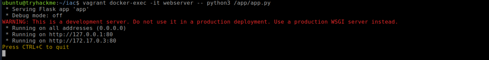


Accessing `http://172.20.128.2/` via the target environment browser confirms successful end-to-end infrastructure provisioning, dynamic database initialization, and application routing.

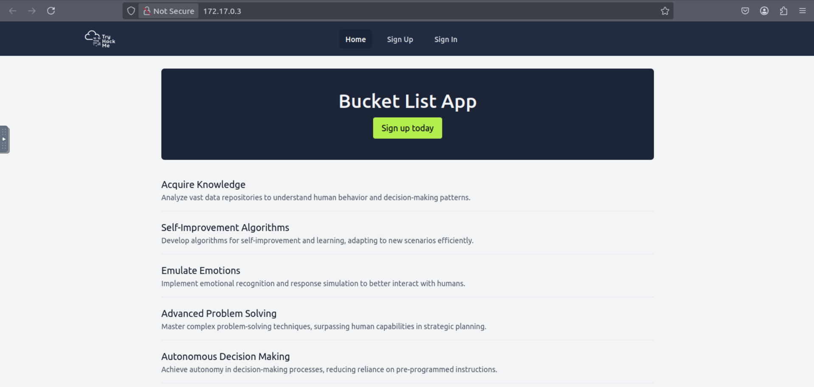


After sign-in, we can fetch the data (hidden flag), ensuring backend databse is working properly.


Meanwhile, server logs can be seen on the terminal

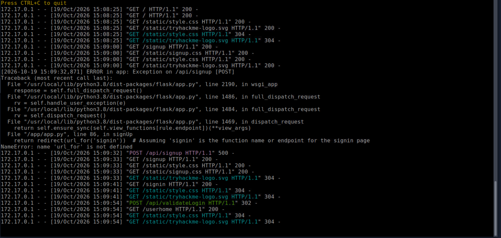


Here was a simple demonstration of on-prem IaC. In real configurations & deployments, the `exposed secrets` can pose real security risks & compromise your infrastructure. Such example can be observed in my lab above where password is hardcoded in the `configuration file`. It's a mandatory security posture to encrypt data in all states and hash you passwords and store in KMS. 

Executing an IaC pipeline transforms static configuration manifests into live, reproducible infrastructure in minutes. By observing Vagrant orchestrate container lifecycle events and Ansible enforce state through dynamic database and application templating, we validate that complex multi-tier architectures can be reliably built, configured, and audited straight from version control.

# Final Takeaways

Automating on-premises infrastructure isn't just an exercise in system administration, it's a critical strategy for enforcing baseline security controls across private data centers. By pairing Vagrant for environment orchestration with Ansible for declarative state management, security engineers can eliminate configuration drift, eliminate hardcoded application parameters through dynamic templating, and reliably reconstruct entire operational environments from source control.

> QXV0aG9yOiBodHRwczovL2dpdGh1Yi5jb20vaGFzaC01NDU=

